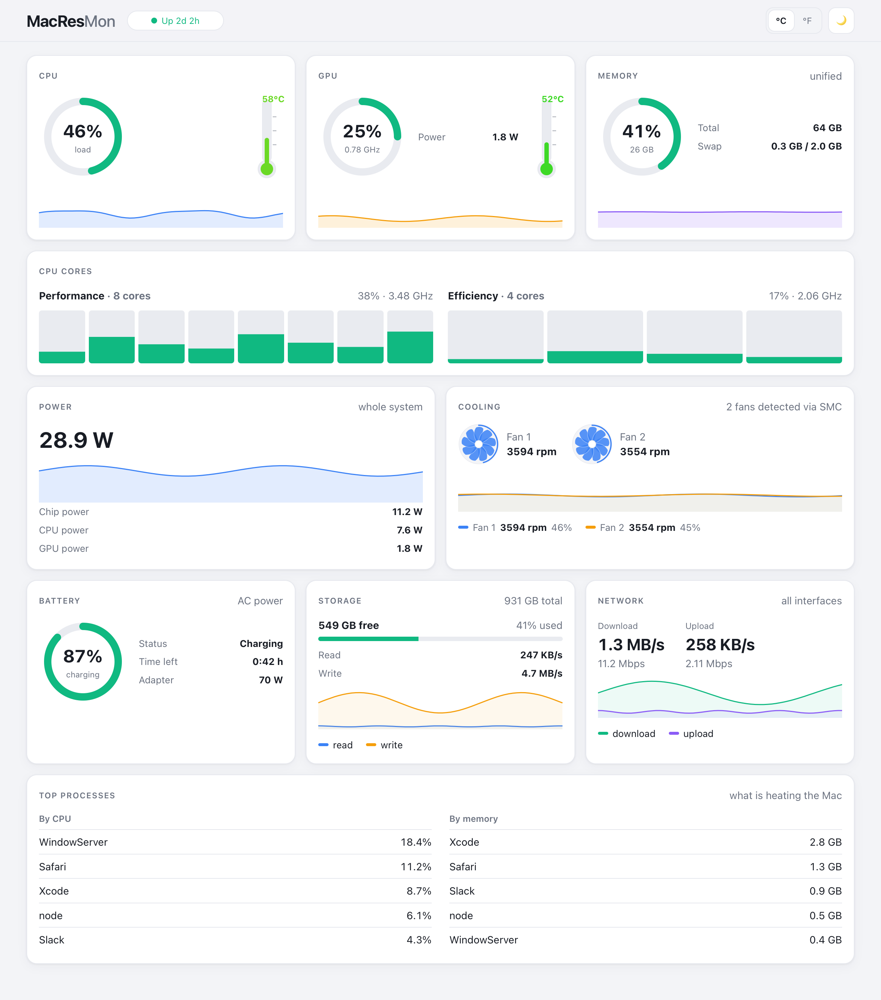
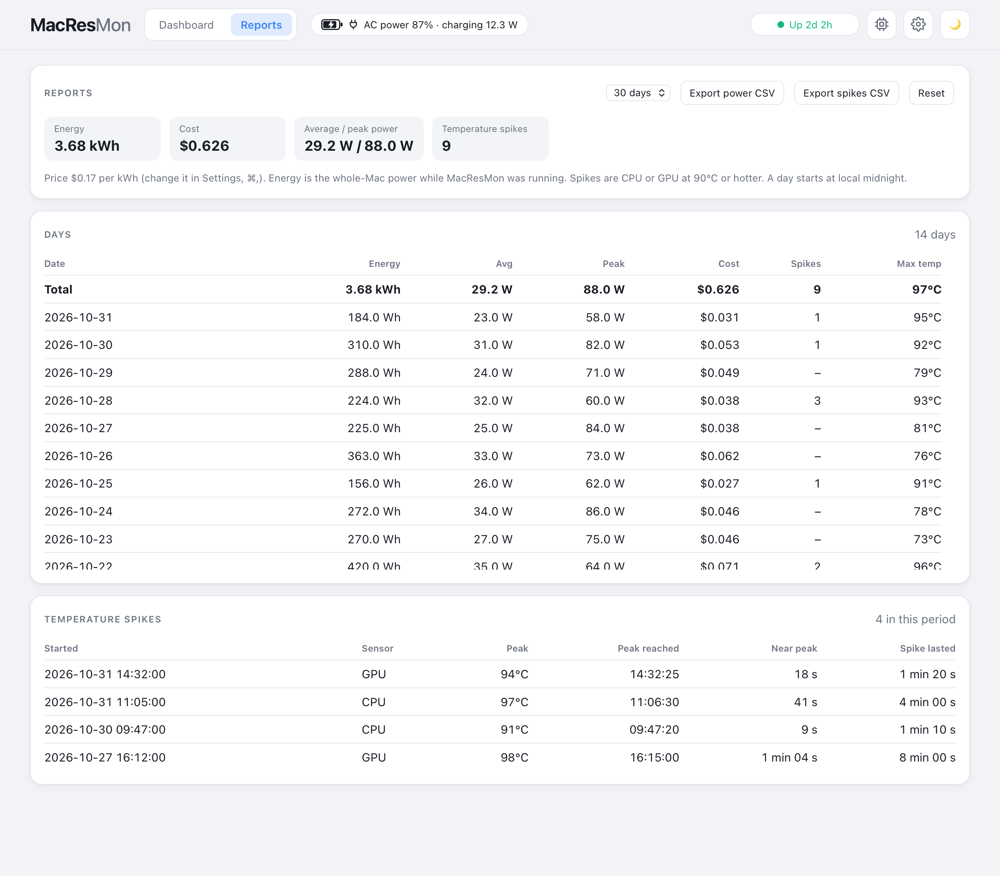

# MacResMon — macOS System Monitor for Apple Silicon

**Free, open-source Mac system monitor with live CPU and GPU usage, temperature monitoring, fan speed (RPM), and a menu bar readout.**

See memory usage, power consumption, battery status, disk activity, network speed, and top processes in one window. MacResMon pairs a native Swift shell with a bundled React interface in WKWebView. Sensor access needs no `sudo` or kernel extensions; the app runs without Electron or a Node.js runtime.

> **Apple Silicon only.** Intel Macs are not supported: the sensor source, [macmon](https://github.com/vladkens/macmon), reads Apple Silicon performance counters that Intel Macs do not have. On an Intel Mac the app will not give you CPU, GPU, power, temperature or fan data.

[](LICENSE)


<picture>
  <source media="(prefers-color-scheme: dark)" srcset="docs/screenshot-dark.png">
  
</picture>

*Current interface with demo readings, shown in light or dark mode according to your preferred color scheme. [Light screenshot](docs/screenshot-light.png) · [Dark screenshot](docs/screenshot-dark.png).*

<picture>
  <source media="(prefers-color-scheme: dark)" srcset="docs/reports-dark.png">
  
</picture>

*The Reports tab (demo data): power use and cost per day, and the temperature spike log. [Light screenshot](docs/reports-light.png) · [Dark screenshot](docs/reports-dark.png).*

**[⬇ Download MacResMon.dmg](https://github.com/proars/MacResMon/releases/latest/download/MacResMon.dmg)** · [all releases](https://github.com/proars/MacResMon/releases)

[Download and install](#download-and-install) · [Features](#features) · [Build and run](#build-and-run) · [FAQ](#faq) · [Troubleshooting](#troubleshooting) · [Contributing](#contributing)

## Why MacResMon?

When your MacBook Pro gets hot or its fans spin up, check temperatures, fan RPM, CPU and GPU load, power draw, and the busiest processes together. Keep the live CPU and temperature readout in the macOS menu bar, then open the dashboard for a closer look.

MacResMon monitors your Mac; it does not change fan speeds, CPU settings, or thermal limits.

## Download and install

1. Download **[MacResMon.dmg](https://github.com/proars/MacResMon/releases/latest/download/MacResMon.dmg)** from the [latest release](https://github.com/proars/MacResMon/releases/latest). It needs an Apple Silicon Mac with macOS 13 or later.
2. Open the disk image and drag **MacResMon** onto the **Applications** shortcut.
3. Open MacResMon from Applications (or Launchpad). The first time, macOS may say it cannot verify the app, because it is signed ad hoc and not notarized by Apple. To allow it:
   1. In the warning, click **Done** (not *Move to Trash*).
   2. Open **System Settings → Privacy & Security** and scroll down to the message "MacResMon was blocked to protect your Mac".
   3. Click **Open Anyway**, then confirm with your password or Touch ID and click **Open**.

   The button appears only after a fresh attempt to open the app, and this is needed only once.
4. Optional: open **Settings** (⌘, or the gear button) and switch on **Launch at login**; choose what the menu-bar readout shows.

If macOS still refuses to open the app, remove the download quarantine flag in Terminal and open it again: `xattr -dr com.apple.quarantine /Applications/MacResMon.app`.

The app is not notarized. If the icon keeps bouncing in the Dock and the app never starts (the system log shows `AppleSystemPolicy ... would not allow process`), the system's security check is stuck: quit the stuck process (`pgrep -x MacResMon`, then `kill -9 <pid>`), restart the Mac and open the app again. If it still does not start, [build it from source](#build-and-run) on your Mac.

To check the download, compare `shasum -a 256 MacResMon.dmg` with the SHA-256 in the release notes. To remove the app, quit it and delete it from Applications; its data is the report log in `~/Library/Application Support/MacResMon/` and its settings (`defaults delete com.macresmon.app`).

You can also [build it from source](#build-and-run).

## Features

- **Cooling**: a spinning rotor per fan (speed follows RPM), one filled graph with a line per fan, and a live legend with RPM and % of maximum
- **CPU, GPU, memory**: load rings, thermometers in °C or °F, swap, 60-sample trends (one minute at the default interval), and a load column for every CPU core, grouped by Performance and Efficiency cluster
- **Power and battery**: whole-system watts, chip (CPU + GPU + ANE + RAM), CPU and GPU power, charge level, charging state, time left and power adapter wattage
- **Header**: **Dashboard / Reports** tabs, a power-source badge ("AC power 80%", with charging or draining watts and time left on battery), a **This Mac** button that opens the chip, macOS version, core counts per tier, GPU cores, and memory and disk usage, a **gear** button that opens Settings, and the light/dark switch. Hover the badge, the button or a core column for details
- **Top processes**: top 5 by CPU and by memory, to answer "what is heating the Mac?"
- **Storage and network**: free space, disk read/write speed, download and upload in MB/s and Mbps
- **Menu bar**: a fan icon with a live readout of the parts you choose in Settings (CPU % and temperature by default; while an alert is active it shows `⚠︎` and turns orange, or red for a critical alert, and it blinks for a few seconds when a new alert appears, so you notice it with the window closed) and a menu with "Open MacResMon" and Settings first, then the details and active alerts
- **Alerts and notifications**: alert chips in the window header (the two most severe, plus "+N") and a macOS notification when CPU or GPU reaches 90 °C, a fan reaches 95% of its maximum speed, memory is 90% full, the battery is at 10% or the disk is almost full; they also arrive while the window is closed
- **Reports** (the Reports tab): a log kept between launches of power use per day (energy, average and peak watts, cost at your electricity price) and of temperature spikes (every time CPU or GPU reached 90 °C: start, sensor, peak, when the peak was reached, how long the temperature stayed within 1 °C of it, and how long the whole spike lasted), with a period filter (7, 14, 30, 90 days or all), CSV export of both tables and a reset
- **Settings** (⌘, or the gear button in the header), in sections: launch at login (starts hidden in the menu bar), keep running when the window is closed; **Menu bar** with a checkbox for each part of the readout (CPU load, CPU temperature, GPU load, GPU temperature, memory used, fan speed, power, battery level); notifications (with a test button); temperature unit and update interval (0.5, 1, 2 or 5 seconds; 1 by default); electricity price per kWh and a button that erases the reports. Every setting is saved at once and restored at the next launch, together with the window positions, the theme, the selected tab and the report period
- **Window and login**: the red close button hides the window and the Dock icon while the menu-bar item keeps monitoring; with Launch at login the app starts hidden
- Light and dark theme (remembered), and an app icon

## Requirements

An **Apple Silicon Mac running macOS Ventura 13 or later** is required to run the app. Intel Macs are unsupported. Available sensor readings depend on your Mac model and macmon; fanless Macs have no fan RPM to report. Testing so far has been on one Apple Silicon MacBook Pro, so reports from other models are welcome.

To build from source (not needed for the downloaded app), install:

| Tool | Needed for | Install |
| --- | --- | --- |
| Mac with Apple Silicon, macOS 13+ | everything | |
| [macmon](https://github.com/vladkens/macmon) | sensor data (CPU, GPU, power, temperatures, fans); copied into the app when you build it | `brew install macmon` |
| Swift (Xcode Command Line Tools; full Xcode is not needed) | building the app | `xcode-select --install` |
| [Node.js](https://nodejs.org) 18+ | building the interface (the app itself does not use Node) | `brew install node` |

## Build and run

To build it yourself instead of downloading the release, clone this repository using GitHub’s **Code → HTTPS** URL, or choose **Download ZIP** and extract it. Open Terminal in the project folder, then run:

```bash
npm install                               # once
npm run native:build                      # builds "native/build/MacResMon.app"
open "native/build/MacResMon.app"
```

The build packs the interface, the Swift app and a copy of `macmon` into one app of about 4 MB. Copy it to `/Applications` if you like, and rebuild with the same command after changing any code.

How the build works, how to make a `.dmg`, the checks and the architecture are in [docs/DEVELOPMENT.md](docs/DEVELOPMENT.md).

The build signs the app ad hoc, without Developer ID signing or notarization. A downloaded or AirDropped copy may be blocked by Gatekeeper on another Mac; the steps are under [Download and install](#download-and-install). Developer ID signing and notarization are planned for distribution.

## Using the app

- **Window**: ⌘R reloads the interface. With "Keep running in the menu bar" on (the default) the red close button hides the window and the Dock icon, and the app keeps monitoring from the menu bar; choose "Open MacResMon" in the menu-bar menu to bring both back. With the option off, closing quits the app; with the menu-bar item hidden, the window stays in the Dock instead. Quit with ⌘Q or from the menu-bar item.
- **Menu bar**: click the fan icon to open the window or Settings, or to see CPU, GPU, memory, fans, power, battery and active alerts. What the icon's readout shows is chosen under Menu bar in Settings.
- **Notifications**: macOS asks for permission the first time one is needed (or when you press "Send test notification" in Settings).
- **Launch at login**: switch it on in Settings. The app then starts without a window or Dock icon, only the menu-bar item (unless the menu-bar item is switched off, then the window opens); `MacResMon --background` does the same by hand. macOS may ask you to approve it in System Settings › General › Login Items; Settings has a button that opens it.
- **Reports**: switch to the Reports tab in the header. It records while the app runs, also with the window hidden or closed to the menu bar, but not while the app is quit. Energy is the whole-Mac power reported by the sensors (`sys_power`) times the time it covers; a gap longer than 10 s (sleep) adds at most 10 s. Cost is energy times the price per kWh from Settings and is calculated when you look, so changing the price re-costs every day. A day starts at local midnight. "Export power CSV" and "Export spikes CSV" save the rows of the selected period (a save dialog opens); "Reset" (or "Reset reports…" in Settings) erases everything after a confirmation, so export first if you need the data.
- The temperature unit (°C, °F or follow the system region) is set in Settings only and applies to the window, the menu bar and notifications.

## How it works

A Swift app reads the sensors through [macmon](https://github.com/vladkens/macmon) (bundled in the app) and a few macOS tools, once per update interval (1 second by default). It shows the readings in a window (a React interface in a WKWebView), in the menu bar and in notifications. Once per tick it also feeds the report log, a small file in `~/Library/Application Support/MacResMon/`. Nothing is sent over the network. Details for developers are in [docs/DEVELOPMENT.md](docs/DEVELOPMENT.md).

## FAQ

**How do I check fan speed and CPU temperature on an Apple Silicon Mac?**
The Cooling card shows each reported fan’s RPM and history graph; the CPU and GPU cards show temperatures. MacResMon uses macmon for Apple Silicon sensor data, including M-series Macs such as M1, M2, M3, M4, and M5. Readings depend on model and macmon support; this is not a claim that every model has been tested. A missing fan reading can mean a fanless Mac or unavailable sensor data.

**Can MacResMon control fan speed?**
No. It is a fan speed monitor, not a fan controller. macOS continues to manage cooling.

**Is this an Activity Monitor alternative?**
MacResMon is useful for a combined hardware dashboard with temperatures, fan RPM, power draw, and a menu bar readout. Activity Monitor provides more detailed process inspection and process management; MacResMon shows the top five CPU and memory consumers.

**Does it need `sudo`?**
No. Sensor data comes from [macmon](https://github.com/vladkens/macmon), which reads Apple's performance counters without root.

**Does it work on Intel Macs?**
No. macmon supports Apple Silicon only, and the app has no other sensor source, so it does not work on Intel Macs. Support would need a separate reader for Intel (temperatures and fans through the SMC); it is not planned yet.

**Is it on the Mac App Store?**
No. Download the `.dmg` from the [releases page](https://github.com/proars/MacResMon/releases) (see [Download and install](#download-and-install)) or build the app from source.

**Is my data sent anywhere?**
No. The app has no server and makes no network connections; everything stays on your Mac. The only file it writes is the report log, `~/Library/Application Support/MacResMon/reports.json`; delete it or use Reset to erase it.

**Why is the interface built with web technology?**
It keeps the charts easy to change and to preview; the native Swift shell does everything that needs the system (sensors, menu bar, notifications, launch at login). Node is only used to build the interface.

**Which Macs has it been tested on?**
It was developed and tested on a single Apple Silicon MacBook Pro. Reports for other models are welcome as issues.

## Known limitations

- **Sensor coverage:** Apple Silicon only; readings vary by hardware and macmon support. There is no fan control.
- **Visible-window memory use:** the WKWebView WebContent process has shown memory growth while the dashboard stays visible. The cause is still under investigation; a hidden window stops receiving interface updates.
- **Hidden login start:** the app recognizes a login launch from the launch event macOS sends to login items; this was not tested through a real log-out and log-in, so if the window still opens at login, use `--background` in a LaunchAgent and open an issue.
- **Reports:** energy comes from the system power sensor and counts only while the app runs; spikes use the same 90 °C limit as the alerts (not configurable); the log keeps the newest 5000 spikes. A spike still in progress when the app crashes is not saved.
- **Process and I/O detail:** process CPU usage is the decaying average reported by `ps`. Network and disk rates are system-wide, with no per-process or per-interface breakdown.
- **Distribution:** Developer ID signing, notarization, and a Homebrew cask are not implemented.

## Contributing

Bug reports, model compatibility reports, and pull requests are welcome. Open an issue in this repository with your Mac model and chip, macOS version, macmon version (`macmon --version`), steps to reproduce, and any relevant error output. Remove private information from logs or screenshots before sharing.

For code changes, run the checks listed in [docs/DEVELOPMENT.md](docs/DEVELOPMENT.md) (`npm test`, `npm run build`, `node rendercheck.mjs`, and `npm run native:check` when touching `native/`). Keep Swift and JavaScript alert rules in sync. If you change the snapshot contract, update both the native collector and the React interface.

## Troubleshooting

- **A page saying "UI not found"**: the interface is not built; use `npm run native:build` (or `npm run build` before `native:dev`).
- **"macmon was not found"**: install it with `brew install macmon` (the build copies it into the app).
- **"Stale" badge**: macmon stopped sending frames for more than 5 seconds (or 2.5 update intervals, if that is longer).
- **No notifications**: allow them in System Settings › Notifications › MacResMon, and use "Send test notification" in Settings. They are not available when started with `npm run native:dev`.
- **The menu-bar item is missing**: it is switched off in Settings, or the menu bar is full (the item can hide behind the notch or other icons).
- **The build prints `ld: warning: search path '/Library/Developer/CommandLineTools/Developer/...' not found`** (five lines): the app is built correctly, but SwiftPM 6's default build engine adds the platform folders of a full Xcode (`<developer dir>/Developer/Library/Frameworks` and `<developer dir>/Developer/usr/lib`) and with only the Command Line Tools those two folders do not exist. Create them once (admin password; the folders are lost when the Command Line Tools are updated, then run it again): `sudo mkdir -p /Library/Developer/CommandLineTools/Developer/Library/Frameworks /Library/Developer/CommandLineTools/Developer/usr/lib`. Installing full Xcode does the same. Do not silence the linker (`-Xlinker -w`) and do not use the deprecated `--build-system native`.
- **The build fails**: check that `macmon` is installed (`which macmon`), Swift works (`swift --version`) and `npm install` has been run.

## Star history

[](https://star-history.com/#proars/MacResMon&Date)

## Credits and license

Sensor data comes from [macmon](https://github.com/vladkens/macmon) by vladkens (MIT), which is bundled in the app together with its license notice. This project is released under the [MIT License](LICENSE).
